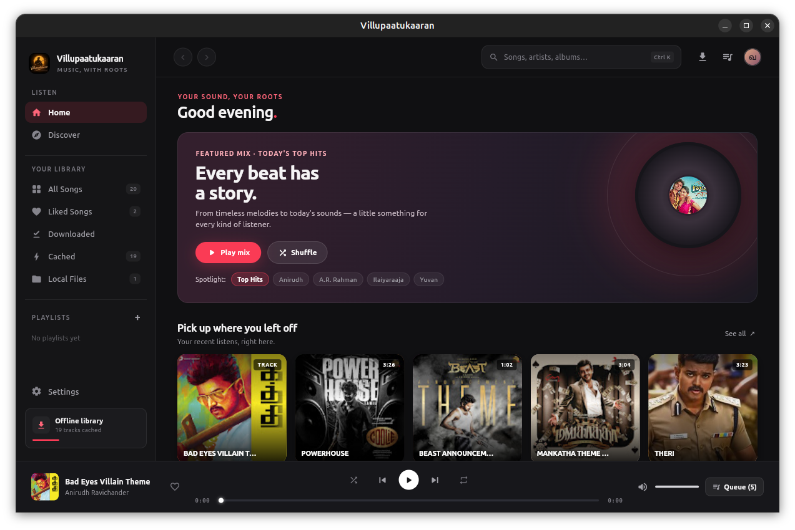

# Villupaatukaaran (வில்லுப்பாட்டுக்காரன்)

A desktop music player for Tamil music, streaming from YouTube Music. No login, no ads. Built with Flutter for Linux and Windows.



## Download

Get the latest build from [Releases](https://github.com/gokulnaatheswaran/villupaatukaaran/releases/latest).

| Platform | File |
| :--- | :--- |
| Debian / Ubuntu | `villupaatukaaran_1.3.0_amd64.deb` |
| Linux portable | `villupaatukaaran_1.3.0_linux_x64.tar.gz` |
| Windows portable | `villupaatukaaran_1.3.0_windows_x64.zip` |

**Debian / Ubuntu**

```bash
sudo apt install ./villupaatukaaran_1.3.0_amd64.deb
villupaatukaaran
```

**Linux portable**

```bash
tar -xzf villupaatukaaran_1.3.0_linux_x64.tar.gz
cd villupaatukaaran
./villupaatukaaran
```

**Windows portable**: extract the zip and run `villupaatukaaran.exe`.

## Features

- Stream Tamil songs, albums and playlists without login or ads
- Offline cache and downloads
- Local music folders
- Playlists, liked songs, recently played
- Queue management and system tray controls

## Build from source (Linux)

Requires Flutter 3.24.5+ and:

```bash
sudo apt install clang cmake ninja-build pkg-config libgtk-3-dev libayatana-appindicator3-dev libmpv-dev
flutter pub get
flutter run -d linux           # run
flutter build linux --release  # build
bash scripts/build_deb.sh 1.3.0  # package .deb
```

## License

[MIT](LICENSE)
